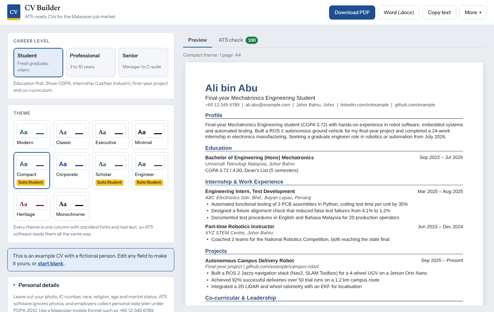
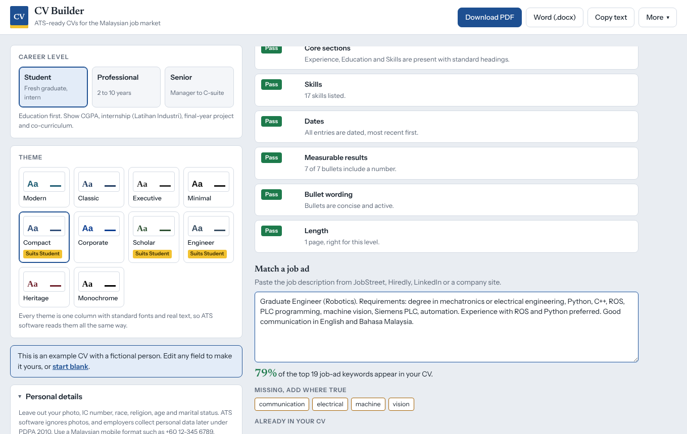

# CV Builder

A browser-based CV builder for the Malaysian job market. Pick your career level, choose one of ten themes, fill in your details and download an ATS-friendly PDF or Word file. Everything runs locally in your browser: no account, no server, no data leaves your machine.

**Live demo:** https://muhamadmursyied.github.io/cv-builder/



## Features

- **Three career tiers**, each with its own section order, headings and guidance:
  | Tier | Leads with | Target length |
  |---|---|---|
  | Student / fresh graduate | Education (CGPA), internship, final-year project, co-curriculum | 1 page |
  | Mid-career professional | Summary, skills, experience with measurable results | 1 to 2 pages |
  | Senior / executive | Executive summary, key achievements, core competencies | 2 to 3 pages |
- **Ten themes** (Modern, Classic, Executive, Minimal, Compact, Corporate, Scholar, Engineer, Heritage, Monochrome). Each one is ATS-safe by design; themes change only typography, accent colour and heading style.
- **Exports**: text-based PDF, Word (.docx), plain text (.txt) and a JSON backup you can load later.
- **ATS check**: a score out of 100 with fixes for missing contact details, undated entries, weak bullet wording, length, sensitive personal data and more.
- **Job-ad match**: paste a job description and see which of its keywords your CV already uses and which are missing.
- **Malaysian conventions built in**: +60 phone format, CGPA and MUET band, Latihan Industri, professional bodies (BEM, MBOT, MIA), notice period, and a reminder to leave out IC number, race, religion and photo (PDPA 2010).
- **Live A4 preview** that paginates exactly like the exported PDF.
- **Autosave** to your browser, so a refresh never loses your work.



## Why the output is ATS-friendly

Applicant tracking systems (Workday, SuccessFactors, Taleo, and the parsers behind JobStreet and Hiredly) read the text layer of your file and map it to fields. Most rejections come from files they cannot read. This tool avoids the usual causes:

| Common ATS failure | What this tool does |
|---|---|
| PDF is an image (canvas or screenshot export) | PDF text is drawn with real fonts; every word is selectable and extractable |
| Two-column layouts, tables, text boxes | Single column only, in reading order |
| Icons, photos, skill bars, graphics | None. Contact details are plain text |
| Unusual fonts or symbols | Helvetica/Arial or Times only; emoji and unsupported symbols are removed and flagged |
| Content in page headers/footers | Everything is in the document body |
| Non-standard headings ("My Journey") | Standard headings: Work Experience, Education, Skills |
| Inconsistent dates | Dates are entered with a month picker and always rendered as "Jan 2024 – Present" |

You can verify this yourself: run `pdftotext your_CV.pdf -` (from poppler-utils) or open the "What the ATS reads" panel in the app.

No tool can guarantee that every employer's system accepts a CV, because each company configures its ATS differently. The checks here cover the failures that are common and fixable.

## Run it

It is a static site with no build step and no backend.

```bash
git clone https://github.com/MuhamadMursyied/cv-builder.git
cd cv-builder

# Option 1: open the file directly
xdg-open index.html          # Linux; use `open` on macOS

# Option 2: serve it locally (recommended)
python3 -m http.server 8000
# then visit http://localhost:8000
```

Works in current Chrome, Edge, Firefox and Safari. The only third-party code is [jsPDF](https://github.com/parallax/jsPDF) 2.5.1 (MIT), vendored in `vendor/` so the app also works offline.

To deploy, push the folder to any static host (GitHub Pages, Netlify, Cloudflare Pages). For GitHub Pages: Settings, Pages, deploy from the `main` branch root.

## Project structure

```
index.html            page markup and script order
css/styles.css        app styling (light and dark)
js/themes.js          the 10 CV themes (font, accent, heading style, density)
js/tiers.js           career tiers, section definitions, Malaysian guidance text
js/samples.js         example CVs for each tier (fictional people)
js/blocks.js          CV data -> list of blocks shared by every exporter
js/layout.js          positions blocks on A4 pages using real PDF font metrics
js/preview.js         draws the layout as SVG for the live preview
js/export-pdf.js      draws the same layout with jsPDF
js/export-docx.js     writes a .docx (WordprocessingML + tiny ZIP writer)
js/export-text.js     plain-text export
js/ats.js             ATS checks and job-ad keyword match
js/editor.js          builds the editor form
js/app.js             state, autosave, events and downloads
vendor/               jsPDF (MIT)
```

### How it works

```
CV data ──> blocks.js ──┬──> layout.js ──┬──> preview.js   (SVG on screen)
                        │                └──> export-pdf.js (PDF file)
                        ├──> export-docx.js                 (Word file)
                        ├──> export-text.js                 (plain text)
                        └──> ats.js                         (checks)
```

The preview and the PDF come from the same layout pass, which measures text with the PDF's own font metrics. Arial and Times New Roman share those metrics, so line and page breaks on screen match the downloaded file.

Plain scripts (not ES modules) are used on purpose: they run when `index.html` is opened straight from disk, where browsers block module imports.

## Adding a theme

Add one line to `js/themes.js`:

```js
{ id: 'ocean', name: 'Ocean', font: 'sans', accent: '#0a6c74', heading: 'rule',
  align: 'left', nameCase: 'normal', dates: 'right', density: 'normal', tiers: ['mid'] }
```

`heading` can be `rule`, `caps`, `capsrule`, `overline` or `plain`; `dates` can be `right` or `inline`; `density` can be `normal` or `compact`. No other change is needed: preview, PDF and DOCX all read these values.

## Limitations

- The standard PDF fonts cover Latin script only. Names in Chinese, Tamil or Jawi characters are removed from the export (and flagged by the ATS check). Write names in their romanised form.
- Keyword matching is literal. It will not know that "JS" and "JavaScript" are the same skill, so mirror the job ad's wording.

## License

MIT. See [LICENSE](LICENSE). jsPDF is MIT licensed; see `vendor/jspdf.LICENSE`.
